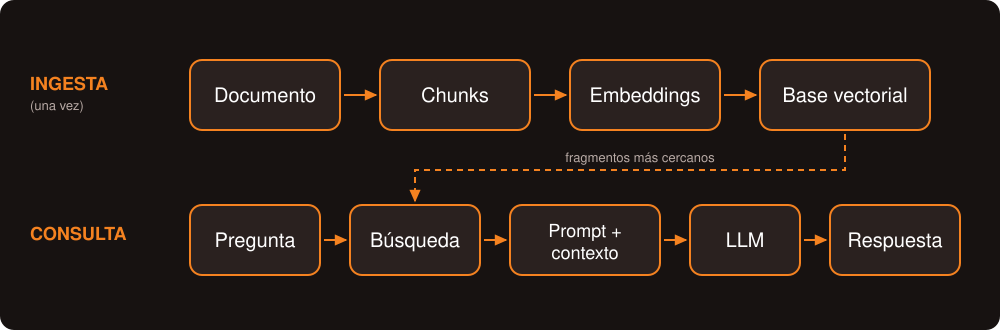
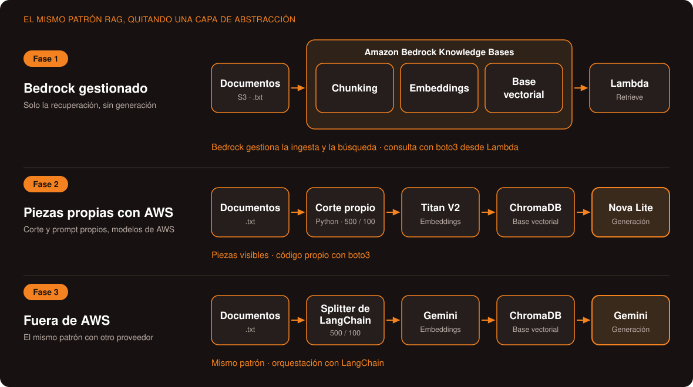

# Amazon Bedrock: las ventajas reales de un RAG gestionado en AWS

> Proyecto presentado en la charla *«Amazon Bedrock: las ventajas reales de un RAG gestionado en AWS»*, en **CodeOn 2026**, organizado por Developer Student Clubs UTP.

**Idea central:** Bedrock no es magia: ofrece componentes de RAG gestionados que evitan implementar y mantener ciertas piezas por separado. Entender qué hay detrás permite decidir cuándo conviene utilizarlos y cuándo tiene sentido construir una solución propia.

---

## ¿Qué hay detrás de un RAG?

RAG significa *Retrieval-Augmented Generation*, o generación aumentada por recuperación. Combina la búsqueda de información relevante con un modelo que utiliza esa información para elaborar una respuesta.



| Pieza | Qué hace |
|---|---|
| **Chunking** | Divide los documentos en fragmentos que se pueden recuperar por separado |
| **Embeddings** | Representa cada fragmento mediante un vector numérico que permite buscar contenido semánticamente parecido |
| **Base vectorial** | Almacena los vectores y permite recuperar fragmentos cercanos a una consulta |
| **Generación** | Un modelo redacta una respuesta utilizando los fragmentos recuperados como contexto |

La **R** de RAG corresponde a *Retrieval* (recuperación); la **G**, a *Generation* (generación). En la fase de recuperación se buscan fragmentos relevantes. En la generación, el modelo utiliza el contexto recuperado para elaborar una respuesta.

---

## Las tres fases: el mismo patrón RAG, quitando una capa de abstracción

La diferencia entre las tres implementaciones está en quién se encarga de estas piezas y cuánto control tiene el desarrollador sobre ellas.

| Característica | Fase 1: Bedrock gestionado | Fase 2: componentes propios en AWS | Fase 3: fuera de AWS |
|---|---|---|---|
| **Enfoque** | Servicio gestionado; se probó la recuperación | Componentes conectados mediante código propio | Componentes conectados con LangChain |
| **Entorno** | Cuenta de AWS | Entorno temporal de laboratorio de AWS | Máquina local |
| **División de documentos** | Bedrock: 300 tokens, 20 % de traslape | Función propia: 500 caracteres, 100 de traslape | RecursiveCharacterTextSplitter: 500 / 100 |
| **Embeddings** | Gestionados por Bedrock | Titan Text Embeddings V2 | Gemini (gemini-embedding-001) |
| **Base vectorial** | Gestionada por Bedrock | ChromaDB local | ChromaDB local |
| **Generación** | No validada (límite de cuota) | Nova Lite (API Converse) | Gemini (gemini-3.6-flash) |
| **Orquestación** | Knowledge Bases + Lambda (Retrieve) | Código propio con boto3 | Cadena de LangChain |



> Estas fases ilustran diferentes formas de construir un RAG; no son una comparación controlada de rendimiento. En la Fase 3 cambiaron tanto el proveedor de modelos como el framework de orquestación.

### Explora cada fase

- **[Fase 1: Bedrock gestionado](phase1-direct-retrieval/README.md)** — Solo la recuperación, sin generación
- **[Fase 2: Piezas propias con AWS](phase2-component-based-rag/README.md)** — Corte y prompt propios, modelos de AWS
- **[Fase 3: Fuera de AWS](phase3-code-first-rag/README.md)** — El mismo patrón con otro proveedor

---

## El caso de uso

Un asistente que responde preguntas sobre fichas técnicas ficticias de tres vehículos: Alpha, Beta y Gamma. Se probó con dos preguntas:

- **Real:** *¿Cuáles son las especificaciones de seguridad del modelo Alpha?*
- **Trampa:** *¿Cuál es la garantía extendida del modelo Alpha?* — esa información no existe en los documentos.

---

## Hallazgos y limitaciones

- No medí costos, latencia ni calidad de respuestas. El objetivo del proyecto es entender la arquitectura, no comparar rendimiento entre implementaciones.
- La comparación no está controlada: en la Fase 3 cambiaron al mismo tiempo el proveedor de modelos y el framework.
- Se utilizaron solo tres documentos cortos. Con una colección tan pequeña, la búsqueda puede devolver una gran parte de los fragmentos disponibles.
- En la Fase 1, la generación con Bedrock no pudo validarse debido a un error `ThrottlingException` asociado a la cuota diaria de tokens de la cuenta utilizada. Esto no demuestra una limitación general de Bedrock.

---

## Requisitos

| Fase | Necesitas |
|---|---|
| **3** (fuera de AWS) | Python 3.10+ y clave de API de Gemini |
| **2** (componentes en AWS) | Credenciales de AWS, acceso a Titan V2 y Nova Lite en us-east-1 |
| **1** (Bedrock gestionado) | Cuenta de AWS, bucket S3, Knowledge Base y Lambda |

> Para explorar el flujo con una ejecución local, empieza por la Fase 3. Si quieres entender qué gestiona Bedrock, ir a Fase 1.

---

## Cómo clonar y empezar

```bash
git clone <URL_DEL_REPOSITORIO>
cd autospec-voice-assistant-rag/phase3-code-first-rag
```

### 1. Crear y activar un entorno virtual

```bash
# Crear el entorno
python -m venv .venv

# Activar en Git Bash
source .venv/Scripts/activate

# Activar en PowerShell
.venv\Scripts\Activate.ps1
```

### 2. Instalar dependencias

```bash
pip install -r requirements.txt
```

### 3. Configurar la clave de Gemini

```bash
# Git Bash
cp .env.example .env

# PowerShell
Copy-Item .env.example .env
```

Abre `.env` y reemplaza el valor de ejemplo por tu propia clave de Gemini. No compartas ni subas ese archivo al repositorio.

### 4. Continuar con la ingesta y la aplicación

Los pasos para construir la base vectorial, ejecutar la ingesta y arrancar Streamlit están en el [README de la Fase 3](phase3-code-first-rag/README.md).

---

## Seguridad

- Nunca publiques claves API ni credenciales de AWS en el repositorio.
- Mantén la clave de Gemini en `.env`, excluida mediante `.gitignore`.
- Oculta las claves y el Account ID en grabaciones y capturas.
- Si una clave se expone, revócala y genera una nueva.

---

## Estructura del repositorio

```
.
├── README.md
├── .gitignore
├── docs/
│   └── images/
│       ├── tres-fases.svg
│       ├── rag-diagrama.svg
│       ├── phase1/
│       ├── phase2/
│       └── phase3/
├── phase1-direct-retrieval/
│   └── README.md
├── phase2-component-based-rag/
│   └── README.md
└── phase3-code-first-rag/
    ├── README.md
    ├── data/
    ├── ingest.py
    ├── rag_chain.py
    ├── app.py
    ├── requirements.txt
    └── .env.example
```

---

## Datos y alcance

Las fichas técnicas utilizadas son ficticias y se prepararon para las pruebas del proyecto. No deben utilizarse datos reales de clientes ni credenciales.

---

Desarrollado por **Sofía Torres** ✨
