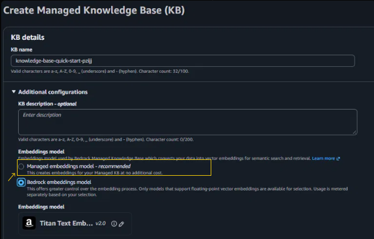
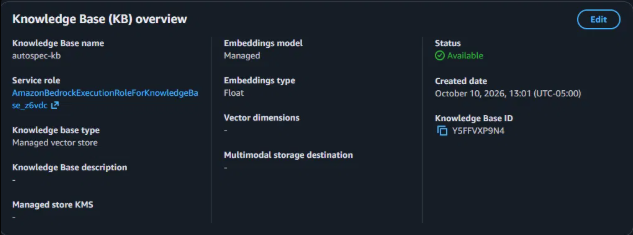
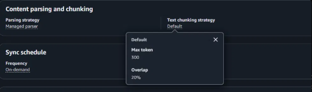
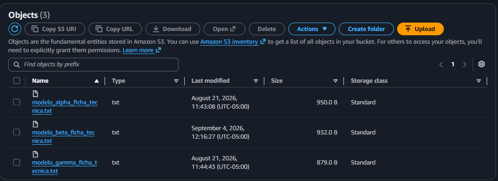
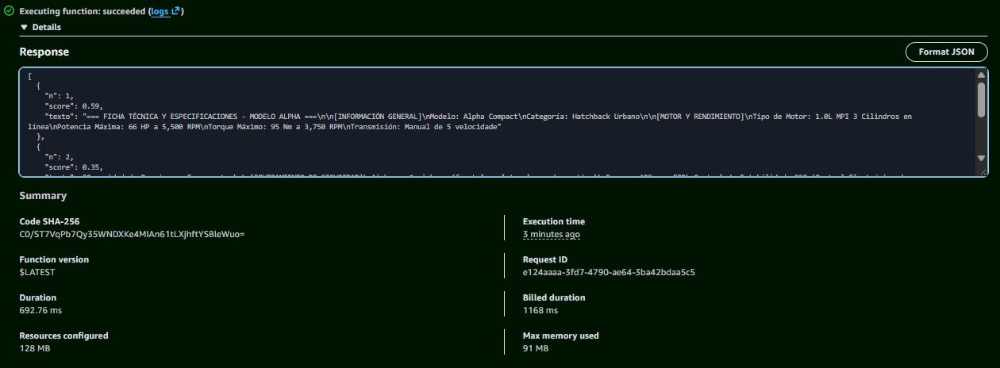

# Fase 1: Amazon Bedrock Knowledge Bases - recuperación administrada

⬅️ [Volver al README principal](../README.md) · ➡️ [Continuar con la Fase 2: RAG por componentes](../phase2-component-based-rag/README.md)

**Estado:** ✅ Recuperación validada · Sin generación de modelo LLM

## 1. Objetivo y alcance

En esta fase construí una prueba de recuperación de información utilizando una **Knowledge Base administrada de Amazon Bedrock**, sin incorporar un modelo generativo al flujo de consulta que validé.

El objetivo fue entender qué resuelve Bedrock por mí, desde la ingesta de documentos hasta la búsqueda de fragmentos relevantes, y comprobar cómo puedo acceder a esos resultados mediante código.

La arquitectura de esta fase sigue este flujo:

**Ingesta de documentos**

S3 → procesamiento y fragmentación → embeddings → almacenamiento vectorial administrado

**Consulta**

Pregunta → Lambda → `Retrieve` → fragmentos recuperados

En esta etapa no busqué construir un asistente conversacional completo. Quise aislar la parte de recuperación para comprenderla antes de añadir la generación de respuestas.

## 2. Qué construí y qué pude validar

| Componente | Resultado |
|---|---|
| Fuente de datos | Tres fichas técnicas en formato `.txt`, almacenadas en S3 |
| Ingesta | Sincronización de los documentos con la Knowledge Base |
| Recuperación en consola | Validada mediante `Standard retrieval only` |
| Recuperación desde Lambda | Implementada mediante `bedrock-agent-runtime` y `Retrieve` |
| Generación de respuestas | No validada de extremo a extremo |

La implementación utiliza dos archivos principales:

- `lambda_function.py`: función Lambda que consulta la Knowledge Base y devuelve los fragmentos recuperados.
- `test_event.json`: evento utilizado para probar la función.

Las fichas técnicas de ejemplo están en [`../phase3-code-first-rag/data/`](../phase3-code-first-rag/data/).

## 3. ¿Qué gestiona Bedrock y qué configuré yo?

Creé la Knowledge Base mediante la opción de **creación rápida** de la consola. En mi prueba seleccioné el nombre y el bucket de S3, mientras que el servicio se encargó de gestionar otros componentes.

| Elemento | Configuración observada |
|---|---|
| Nombre de la Knowledge Base y bucket | Elegidos por mí |
| Parser | Managed parser; los metadatos mostraron `PLAIN_TEXT` |
| Chunking | Valores predeterminados observados: 300 tokens como máximo y 20 % de traslape |
| Modelo de embeddings | Opción administrada; la consola no mostró qué modelo concreto utilizó |
| Almacenamiento vectorial | `Managed vector store` |
| Sincronización | Bajo demanda; en mi caso, la creación inició la primera sincronización |

La consola también me permitió seleccionar un modelo de embeddings explícito. En mi pantalla apareció Titan Text Embeddings V2, con un posible costo adicional indicado por la propia consola. Para esta prueba mantuve la opción administrada.

### Capturas de la configuración



*La consola permite elegir entre la opción administrada y un modelo de embeddings explícito.*



*La Knowledge Base aparece con almacenamiento vectorial administrado y estado `Available`.*



*Valores de chunking observados durante la prueba: 300 tokens y 20 % de traslape.*

## 4. Implementación paso a paso

### Paso 1. Preparar los documentos en S3

1. Creé un bucket en la región `us-east-1`.
2. Subí las tres fichas técnicas en formato `.txt`, codificadas en UTF-8.
3. Mantuve activado `Block all public access`.



*Los archivos del bucket constituyen la fuente de datos de la Knowledge Base.*

### Paso 2. Crear la Knowledge Base

Desde la consola de Amazon Bedrock, accedí a `Knowledge bases` y seleccioné la opción de creación rápida.

Configuré la fuente de datos para utilizar el bucket de S3 y completé la creación.

### Paso 3. Sincronizar los documentos

Comprobé el estado de la sincronización del origen de datos hasta que terminó con el estado `Complete`.

Durante esta etapa, Bedrock procesa los documentos, genera sus representaciones vectoriales y las incorpora al almacenamiento utilizado por la Knowledge Base.

Este procesamiento permite que las consultas posteriores recuperen fragmentos relevantes sin que yo tenga que implementar manualmente toda la canalización de ingesta.

### Paso 4. Probar la recuperación desde la consola

En `Test knowledge base`, seleccioné `Standard retrieval only` y realicé una consulta.

Esta opción permite observar los fragmentos recuperados sin depender de la generación de una respuesta mediante un LLM.

Los resultados de esta prueba se detallan en la siguiente sección.

### Paso 5. Consultar la Knowledge Base desde Lambda

Una vez comprobada la recuperación en la consola, implementé una función Lambda que ejecuta la misma operación mediante el SDK de AWS para Python (`boto3`).

La configuración y el código se encuentran en la sección 6.

## 5. Pruebas y resultados

### 5.1. Recuperación desde la consola

Utilicé la siguiente pregunta:

> ¿Cuáles son las especificaciones de seguridad del modelo Alpha?

La consola devolvió tres fragmentos:

| N.º | Archivo | Contenido recuperado |
|---|---|---|
| 1 | `modelo_alpha_ficha_tecnica.txt` | Inicio de la ficha hasta «Frenos: ABS con EBD» |
| 2 | `modelo_alpha_ficha_tecnica.txt` | Desde «Capacidad de Pasajeros» hasta el final, con un tramo solapado |
| 3 | `modelo_beta_ficha_tecnica.txt` | Sección de seguridad del modelo Beta |

Esta prueba me permitió observar tres comportamientos:

- **Fragmentación:** la ficha de Alpha quedó distribuida en dos fragmentos.
- **Traslape (*overlap*):** parte del contenido se repitió entre fragmentos consecutivos.
- **Recuperación semántica:** también apareció un fragmento de la ficha de Beta, aunque la pregunta mencionaba Alpha.

El tercer resultado es importante: la recuperación busca fragmentos relevantes para la consulta, pero eso no significa que todos pertenezcan al documento esperado. Por eso conviene evaluar tanto la relevancia como la precisión de los resultados.

### ¿Por qué cambió la cantidad de resultados?

Probé distintos valores en `Source chunks`:

- Con el valor 2, la consola mostró dos fragmentos.
- Con el valor 10, mostró tres.

Por lo tanto, el número configurado funciona como un límite máximo solicitado, no como una cantidad fija de resultados garantizados.

No determiné por qué la consulta devolvió exactamente tres fragmentos en esta prueba; no atribuyo ese comportamiento a una causa específica sin más evidencia.

### 5.2. Recuperación desde Lambda

La función Lambda ejecutó `Retrieve` y devolvió una lista con el número de cada fragmento, su puntuación de relevancia y una muestra de su contenido.



*Resultado observado durante las pruebas de recuperación.*

El campo `score` es una puntuación de relevancia devuelta por el servicio. **No es un porcentaje de acierto ni una probabilidad de que el resultado sea correcto.** Sirve para comparar resultados dentro de la consulta, con las limitaciones propias de esa puntuación.

Los valores pueden variar entre consultas y configuraciones.

## 6. Implementación de Lambda

### 6.1. Código

El archivo `lambda_function.py` contiene la siguiente implementación:

```python
import os
import boto3

client = boto3.client(
    "bedrock-agent-runtime",
    region_name="us-east-1"
)


def lambda_handler(event, context):
    resp = client.retrieve(
        knowledgeBaseId=os.environ["KB_ID"],
        retrievalQuery={"text": event["prompt"]},
    )

    resultados = []
    for i, r in enumerate(resp["retrievalResults"], start=1):
        resultados.append({
            "n": i,
            "score": round(r["score"], 2),
            "texto": r["content"]["text"][:300],
        })

    return resultados
```

La función realiza cuatro operaciones:

1. Lee el identificador de la Knowledge Base desde la variable de entorno `KB_ID`.
2. Obtiene la pregunta desde `event["prompt"]`.
3. Ejecuta `client.retrieve()` para recuperar los fragmentos relevantes.
4. Devuelve una lista con el número, la puntuación y los primeros 300 caracteres de cada fragmento.

La implementación es deliberadamente sencilla: su propósito es demostrar el acceso programático a la recuperación, no constituir una función lista para producción.

### 6.2. Configurar la función

1. En Lambda, seleccioné `Create function` → `Author from scratch`.
2. Elegí Python 3.12 como runtime y pegué el código en `lambda_function.py`.
3. Pulsé `Deploy` para aplicar los cambios.
4. En `Configuration` → `Environment variables`, añadí `KB_ID` con el identificador de mi Knowledge Base.
5. En `Configuration` → `General configuration`, configuré un timeout de 30 segundos.
6. En `Permissions`, abrí el rol de ejecución y añadí una política inline de IAM.

### 6.3. Permiso de IAM

La función necesita permiso para ejecutar `bedrock:Retrieve` sobre la Knowledge Base.

Ejemplo de política:

```json
{
  "Version": "2012-10-17",
  "Statement": [
    {
      "Effect": "Allow",
      "Action": "bedrock:Retrieve",
      "Resource": "arn:aws:bedrock:us-east-1:<TU_CUENTA>:knowledge-base/<KB_ID>"
    }
  ]
}
```

Antes de guardar la política, sustituí los marcadores por mi número de cuenta y el ID real de la Knowledge Base.

Esta política ilustra el permiso de recuperación utilizado en la prueba. En un entorno real también hay que verificar las políticas de recursos, las condiciones de acceso y los permisos necesarios para los demás componentes de la arquitectura.

### 6.4. Ejecutar la prueba

Preparé un evento con la misma estructura que `test_event.json`, lo guardé en el editor de pruebas de Lambda y ejecuté la función.

El evento debe contener el campo `prompt`, por ejemplo:

```json
{
  "prompt": "¿Cuáles son las especificaciones de seguridad del modelo Alpha?"
}
```

Si la función devuelve la lista de fragmentos, la llamada de recuperación se ha ejecutado correctamente.

### 6.5. Errores frecuentes

| Error o síntoma | Qué revisar |
|---|---|
| `AccessDeniedException` | Permisos de IAM, ID de cuenta, ID de la Knowledge Base y acceso a los recursos involucrados |
| `KeyError: 'KB_ID'` | Variable de entorno `KB_ID` |
| `KeyError: 'prompt'` | Estructura del evento de prueba |
| `Task timed out` | Duración de la ejecución y timeout configurado |
| `Hello from Lambda!` | Que el código se haya pegado y desplegado correctamente |

## 7. Limitaciones y trabajo pendiente

### Generación de respuestas no validada

Intenté probar la generación con el modo `agentic` y Nova Lite, pero la generación falló con:

`ThrottlingException: Too many tokens per day`

En esa prueba, la recuperación había funcionado, pero no pude completar la generación por el límite de tokens diarios de mi cuenta.

La consola también indicó que `Standard retrieval with answer generation` no estaba soportado para esta Knowledge Base administrada y que debía utilizar la opción `agentic`.

Por tanto, esta fase **no demuestra que la generación funcione de extremo a extremo**. Solo valida la recuperación de fragmentos mediante la consola y la llamada programática a `Retrieve`.

### Otras limitaciones

- La Lambda no incluye manejo de excepciones, reintentos ni registros estructurados. Los añadiría antes de utilizarla en un entorno de producción.
- No medí latencia ni costos reales.
- No realicé una evaluación sistemática de la relevancia de los fragmentos.
- No determiné por qué la consola devolvió tres fragmentos en la consulta de ejemplo.

Estas limitaciones delimitan el alcance de los resultados y ayudan a identificar qué convendría medir en las siguientes fases.

## 8. Limpieza de recursos

Esta prueba utiliza recursos de AWS que pueden generar cargos. Al terminar, realicé o debo realizar las siguientes comprobaciones:

1. Eliminar la Knowledge Base desde Amazon Bedrock y comprobar el tratamiento del almacenamiento vectorial asociado. Verificar en AWS Billing si queda algún recurso facturable.
2. Vaciar el bucket de S3 y eliminarlo.
3. Eliminar la función Lambda.
4. Eliminar el rol de ejecución de Lambda si ya no lo utiliza ningún otro recurso, junto con la política inline creada para la prueba.
5. Revisar AWS Billing posteriormente para comprobar que no queden recursos facturables asociados.

La eliminación de la Knowledge Base y del bucket debe realizarse teniendo en cuenta las dependencias y las opciones de eliminación que presente la consola.

## Conclusión de la fase

Esta primera implementación me permitió comprobar que Amazon Bedrock puede abstraer buena parte de la infraestructura de recuperación: la ingesta de documentos, la generación de embeddings y el almacenamiento vectorial.

También comprobé que puedo consumir esa recuperación desde código sin implementar por mi cuenta el proceso completo de búsqueda vectorial.

El siguiente paso es reducir las abstracciones para entender mejor qué componentes intervienen en un RAG y qué responsabilidades asumo cuando construyo más partes de la solución por mi cuenta.

➡️ [Continuar con la Fase 2: RAG por componentes](../phase2-component-based-rag/README.md)