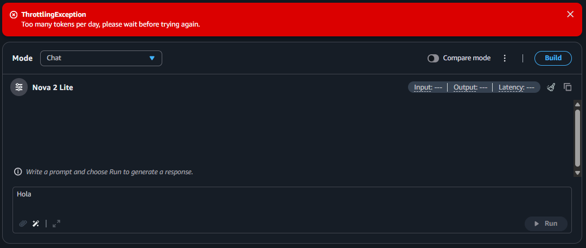
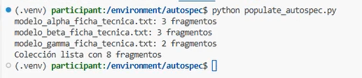
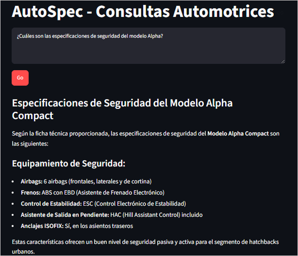
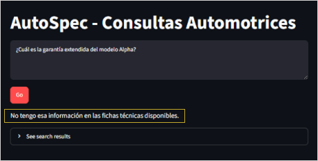
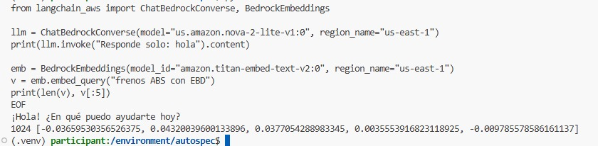

# Fase 2: RAG por componentes (Titan + ChromaDB + Nova Lite)

⬅️ [Volver al README principal](../README.md) · ➡️ [Continuar con la Fase 3: RAG fuera de AWS](../phase3-code-first-rag/README.md)

**Estado:** ✅ Demo funcional · Calidad, costo y latencia no evaluados formalmente

## 1. Objetivo y contexto

En la Fase 1 utilicé una Knowledge Base gestionada de Amazon Bedrock para comprobar cómo funciona la recuperación de información sin implementar manualmente toda la infraestructura.

En esta segunda fase construí el flujo RAG utilizando componentes explícitos: **lo que antes estaba detrás de una solución gestionada, ahora lo dividí en pasos que podía observar y controlar**.

La implementación utiliza Python para fragmentar los documentos, Titan Text Embeddings V2 para generar embeddings, ChromaDB para almacenar y recuperar vectores, y Amazon Nova Lite para generar respuestas mediante la API Converse.

Esta fase surgió durante un laboratorio temporal de AWS. La generación con la Knowledge Base de la Fase 1 había fallado por una cuota diaria de tokens de mi cuenta (`ThrottlingException`). Por ello, construí esta alternativa para continuar experimentando con la generación sin depender de aquella prueba.



*Error de cuota observado en el entorno de laboratorio.*

## 2. Arquitectura y componentes

El flujo de esta implementación se divide en dos etapas.

**Ingesta de documentos**

Fichas técnicas → fragmentación en Python → embeddings con Titan → almacenamiento en ChromaDB

**Consulta y generación**

Pregunta → búsqueda vectorial en ChromaDB → fragmentos recuperados → prompt → Nova Lite → respuesta

| Componente | Implementación |
|---|---|
| Fragmentación | Función propia `dividir`: 500 caracteres por fragmento, con 100 de traslape |
| Embeddings | Titan Text Embeddings V2 (`amazon.titan-embed-text-v2:0`) |
| Base vectorial | ChromaDB local (`./chroma_db`) |
| Generación | Nova Lite (`us.amazon.nova-2-lite-v1:0`), mediante `converse()` |
| Interfaz | Streamlit para formular preguntas y visualizar los fragmentos recuperados |

A diferencia de la Fase 1, aquí puedo inspeccionar directamente cómo se cortan los documentos, qué texto se vectoriza y cómo se construye la consulta que recibe el modelo.

## 3. Archivos principales

- `populate_autospec.py`: ingesta de documentos, fragmentación, generación de embeddings y almacenamiento en ChromaDB.
- `rag_lib.py`: lógica de consulta, recuperación de fragmentos, construcción del prompt y llamada a Nova Lite.
- `rag_app.py`: interfaz de Streamlit para probar el RAG.
- `probar_langchain_aws.py`: prueba independiente de `langchain-aws` con los modelos de Bedrock (sección 7).
- `requirements.txt`: dependencias de Python utilizadas en el proyecto.

### 3.1. Mi propia función de fragmentación

En lugar de utilizar el chunking gestionado de Bedrock, implementé una función sencilla en Python:

```python
def dividir(texto, tamano=500, solape=100):
    chunks, inicio = [], 0

    while inicio < len(texto):
        chunks.append(texto[inicio:inicio + tamano])

        if inicio + tamano >= len(texto):
            break

        inicio += tamano - solape

    return chunks
```

La función trabaja con **caracteres, no con tokens ni con la estructura semántica del documento**.

Con los valores predeterminados:

- Cada fragmento puede contener hasta 500 caracteres.
- El siguiente fragmento comienza 400 caracteres después.
- Se repiten los últimos 100 caracteres del fragmento anterior.

Este método es fácil de implementar, pero puede cortar palabras, frases o secciones en lugares poco convenientes.

Antes de generar los embeddings, cada fragmento recibe el prefijo `Modelo: <archivo>`, utilizando el nombre del archivo de origen. Esto permite incluir el contexto del modelo al que pertenece el contenido.

## 4. Cómo ejecutar el proyecto

### Requisitos

- Python instalado.
- Dependencias de `requirements.txt`.
- Credenciales de AWS configuradas y permisos para invocar los modelos de Amazon Bedrock.
- Acceso a los modelos utilizados en la región `us-east-1`.

Comprueba que los identificadores de los modelos sigan disponibles y que tu cuenta tenga acceso a ellos.

### Ejecución

Desde la carpeta de la Fase 2:

```bash
pip install -r requirements.txt

# Opcional: borrar la base local para comenzar desde cero
rm -rf chroma_db

# Procesar los documentos y crear la colección
python populate_autospec.py

# Iniciar la interfaz
streamlit run rag_app.py
```

**Importante:** `rm -rf chroma_db` elimina la base vectorial local existente. Ejecútalo solo si quieres regenerarla desde cero.

Durante la ingesta, el programa imprime los fragmentos de cada ficha y el total procesado.

En mi ejecución, la interfaz mostró ocho fragmentos: tres de Alpha, tres de Beta y dos de Gamma. La cantidad puede depender del contenido de los documentos y de la implementación; comprueba el resultado de tu propia ejecución.



*La ingesta permite observar los fragmentos generados antes de realizar consultas.*

## 5. Prompt e instrucciones de respuesta

En `rag_lib.py`, el prompt indica al modelo que:

- Responda utilizando la información de los fragmentos recuperados.
- Se centre en el modelo de vehículo mencionado en la pregunta e ignore la información de otros modelos.
- Cuando la información solicitada no aparezca en el contexto, responda exactamente:

> No tengo esa información en las fichas técnicas disponibles.

Cada fragmento se presenta precedido por el nombre del archivo de origen.

Estas instrucciones ayudan a orientar la respuesta y a reducir las respuestas sin respaldo en el contexto. Sin embargo, **un prompt no garantiza por sí solo que el modelo siempre respete las restricciones**.

## 6. Pruebas realizadas

### 6.1. Pregunta respondible

**Pregunta:** ¿Cuáles son las especificaciones de seguridad del modelo Alpha?

En mi prueba, Nova Lite respondió con las características de seguridad de Alpha: seis airbags, ABS con EBD, ESC, HAC e ISOFIX.



### 6.2. Pregunta sin información disponible

**Pregunta:** ¿Cuál es la garantía extendida del modelo Alpha?

Como esa información no estaba disponible en las fichas técnicas, la respuesta fue el mensaje definido en el prompt:

> No tengo esa información en las fichas técnicas disponibles.



Debajo de la respuesta, el panel `See search results` muestra los fragmentos recuperados que se proporcionan al modelo.

### 6.3. ¿Qué implica utilizar `n_results=8`?

En mi ejecución había ocho fragmentos en la colección. Por tanto, solicitar ocho resultados permitía recuperar toda la colección, siempre que la consulta devolviera los ocho elementos.

Esto ayudó a que el modelo recibiera la sección de seguridad que necesitaba, pero no constituye una estrategia escalable: la búsqueda vectorial deja de reducir de manera efectiva el contexto cuando se devuelve toda la colección.

Además, el filtrado por modelo se hacía mediante las instrucciones del prompt, no mediante un filtro aplicado a la búsqueda.

Para una colección mayor, investigaría cómo restringir la recuperación por metadatos del modelo y cómo seleccionar los fragmentos más relevantes sin enviar información innecesaria al LLM.

La lección principal es que **la calidad de la respuesta depende también de la calidad de la recuperación**. Un modelo generativo no puede recuperar información que no está presente en el contexto que recibe.

## 7. Prueba adicional: LangChain con Amazon Bedrock

Como experimento independiente, comprobé que `langchain-aws` podía invocar los modelos de Bedrock utilizados en esta fase.

Esta prueba no sustituye la implementación anterior ni significa que haya reconstruido el RAG con LangChain. Solo verifica el acceso a los modelos mediante esa integración.

Instalé la dependencia:

```bash
pip install langchain-aws
```

Después ejecuté (el script está en `probar_langchain_aws.py`):

```python
from langchain_aws import ChatBedrockConverse, BedrockEmbeddings

llm = ChatBedrockConverse(
    model="us.amazon.nova-2-lite-v1:0",
    region_name="us-east-1"
)

print(llm.invoke("Responde solo: hola").content)

emb = BedrockEmbeddings(
    model_id="amazon.titan-embed-text-v2:0",
    region_name="us-east-1"
)

v = emb.embed_query("frenos ABS con EBD")
print(len(v), v[:5])
```

**Resultado observado:** Nova Lite respondió a la consulta de prueba y Titan devolvió un vector de 1024 dimensiones.



Este experimento confirmó que podía utilizar una abstracción de LangChain para acceder a ambos modelos, aunque la implementación principal de la fase utiliza directamente `boto3`.

## 8. Limitaciones

- No medí costo, latencia ni calidad de recuperación y generación de manera sistemática.
- No aislé el efecto del prefijo de los fragmentos y del aumento de `n_results`.
- La colección de prueba es pequeña; recuperar todos sus fragmentos no demuestra que la estrategia funcione bien a mayor escala.
- El prompt ayuda a limitar las respuestas, pero no ofrece una garantía absoluta de que el modelo no genere información incorrecta.
- El entorno de laboratorio es temporal. Conservé los scripts y las capturas para documentar los resultados.

## Conclusión de la fase

En esta fase construí un RAG con componentes explícitos: implementé la fragmentación en Python, generé embeddings con Titan, almacené los vectores en ChromaDB y utilicé Nova Lite para generar respuestas.

La experiencia me permitió observar responsabilidades que en la Fase 1 estaban detrás de una solución gestionada y comprender mejor la relación entre recuperación y generación.

También comprobé que conseguir una respuesta correcta no basta para evaluar un RAG: es necesario inspeccionar los fragmentos recuperados y probar qué sucede cuando la información no está disponible.

El siguiente paso es profundizar en la implementación desde código y comprender qué otras partes del proceso puedo construir y controlar directamente.

➡️ [Continuar con la Fase 3: RAG fuera de AWS](../phase3-code-first-rag/README.md)