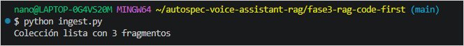
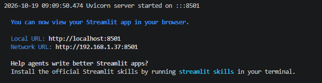

# Fase 3: RAG fuera de AWS (LangChain + ChromaDB + Gemini)

⬅️ [Volver al README principal](../README.md) · [Volver a la Fase 2: RAG por componentes](../phase2-component-based-rag/README.md)

**Estado:** ✅ Completada

En esta fase implementé el patrón RAG fuera de AWS, utilizando **LangChain** para la orquestación, **ChromaDB** como base vectorial y **Google Gemini** para generar embeddings y respuestas. La aplicación se ejecuta localmente mediante Streamlit.

En comparación con la Fase 2, cambiaron dos elementos al mismo tiempo: el proveedor de modelos y el framework de orquestación. Por eso, los resultados permiten observar diferencias entre ambas implementaciones, pero no aislar el efecto de cambiar únicamente de proveedor.

## 1. Contexto y arquitectura

Al desarrollar esta fase no tenía acceso a AWS. Esto me permitió comprobar que el patrón RAG también puede implementarse fuera de ese ecosistema con herramientas alternativas.

### Componentes utilizados

| Componente | Implementación |
|---|---|
| División de documentos | `RecursiveCharacterTextSplitter` de LangChain |
| Tamaño de fragmento | 500 caracteres |
| Traslape | 100 caracteres |
| Embeddings | `gemini-embedding-001` |
| Base vectorial | ChromaDB local (`./chroma_langchain`) |
| Generación de respuestas | `gemini-3.6-flash` |
| Orquestación | Cadena de LangChain: `prompt \| llm \| parser` |
| Interfaz | Streamlit, con visualización de fragmentos recuperados y distancias |

Los nombres y la disponibilidad de los modelos pueden cambiar. Antes de ejecutar el proyecto, conviene verificar que los modelos configurados sigan disponibles para la cuenta y la API utilizadas.

### Flujo de la aplicación

1. Se leen las fichas técnicas desde la carpeta `data/`.
2. LangChain divide los documentos en fragmentos.
3. Gemini genera los embeddings de los fragmentos.
4. ChromaDB almacena los vectores y el contenido asociado.
5. Cuando el usuario realiza una consulta, se genera su embedding y se buscan fragmentos cercanos.
6. Los fragmentos recuperados se incorporan al prompt que recibe el modelo generativo.
7. Streamlit muestra la respuesta y los resultados de la búsqueda para facilitar su inspección.

## 2. Archivos del proyecto

- `ingest.py`: procesa los documentos, los divide con LangChain, genera embeddings con Gemini y almacena los fragmentos en ChromaDB. Anteponer el nombre del archivo a cada fragmento permite identificar su origen, igual que en la Fase 2.
- `rag_chain.py`: recibe las consultas, recupera los fragmentos relevantes, construye el prompt y solicita una respuesta a Gemini. Devuelve la respuesta junto con los fragmentos recuperados y sus distancias.
- `app.py`: implementa la interfaz web con Streamlit.
- `data/`: contiene las tres fichas técnicas utilizadas en las pruebas.
- `.env.example`: plantilla para configurar la variable de entorno de la API.
- `requirements.txt`: declara las dependencias del proyecto.

El registro de conversaciones en SQLite, contemplado en el diseño original, se eliminó para centrar esta fase en el cambio de proveedor y framework.

## 3. Configuración de la API de Gemini

La clave de API se puede gestionar desde [Google AI Studio](https://aistudio.google.com/).

**La clave nunca debe escribirse directamente en el código ni subirse al repositorio.**

El proyecto utiliza la variable de entorno `GEMINI_API_KEY` y `python-dotenv` para cargarla desde un archivo `.env`.

### Paso 1. Crear el archivo de configuración

Desde la carpeta del proyecto, ejecutar:

```bash
cp .env.example .env
```

Después, abrir `.env` y configurar la clave:

```env
GEMINI_API_KEY=tu-clave
```

### Paso 2. Comprobar que Git ignore el archivo

Ejecutar:

```bash
git check-ignore -v .env
```

El comando debe mostrar la regla de `.gitignore` que hace que Git ignore el archivo. Si no muestra ninguna regla, revisar la configuración antes de continuar.

### Consideraciones de seguridad

- El archivo `.env` debe estar incluido en `.gitignore`.
- `load_dotenv()` no sobrescribe por defecto una variable que ya exista en el entorno. Si `GEMINI_API_KEY` ya está definida en la terminal, esa variable tiene prioridad sobre el valor del archivo `.env`.
- No imprimir ni compartir la clave, especialmente durante grabaciones o sesiones de pantalla compartida.
- Si la clave se expone accidentalmente, revocarla en AI Studio y generar otra.
- Las cuotas y los límites disponibles dependen de las condiciones de la cuenta. Conviene verificarlos en Google AI Studio.

## 4. Cómo ejecutar el proyecto

### Paso 1. Instalar las dependencias

Desde la carpeta del proyecto, ejecutar:

```bash
pip install -r requirements.txt
```

Las dependencias utilizadas son:

```text
langchain-chroma
langchain-core
langchain-google-genai
langchain-text-splitters
python-dotenv
streamlit
```

Estas dependencias se identificaron a partir de los imports del código. Para reproducir exactamente el entorno de desarrollo, conviene fijar las versiones utilizadas.

### Paso 2. Preparar la base vectorial

Para reconstruir la base desde cero, se puede eliminar la carpeta local de ChromaDB:

```bash
rm -rf chroma_langchain
```

**Importante:** este comando elimina la base vectorial local. Ejecutarlo únicamente cuando se quiera reconstruirla.

Después, ejecutar la ingesta:

```bash
python ingest.py
```

El proceso divide las fichas técnicas, genera los embeddings con Gemini y almacena los fragmentos en ChromaDB.



En mi ejecución, la ingesta generó **3 fragmentos**, según el resultado mostrado en la terminal. Esta cifra corresponde a esa ejecución y puede variar según el contenido de los documentos y la estrategia de división.

**Importante:** no ejecutar `ingest.py` repetidamente sin controlar el contenido de la colección. Dependiendo de cómo esté implementada la ingesta, podrían duplicarse los fragmentos.

### Paso 3. Iniciar la aplicación

Una vez preparada la base vectorial, ejecutar:

```bash
streamlit run app.py
```

Este comando inicia el servidor local de Streamlit. Por defecto, utiliza el puerto `8501` y muestra en la terminal las direcciones disponibles.



Para abrir la aplicación desde el mismo equipo, acceder a:

[http://localhost:8501](http://localhost:8501)

La dirección de red que muestra Streamlit puede permitir el acceso desde otros dispositivos de la misma red, según la configuración del equipo y del firewall.

Desde la interfaz se pueden enviar preguntas y visualizar las respuestas junto con los fragmentos recuperados y sus distancias.

## 5. Pruebas realizadas

### Pregunta real: información disponible

**Pregunta:** ¿Cuáles son las especificaciones de seguridad del modelo Alpha?

El RAG respondió con los cinco puntos de seguridad de Alpha. El fragmento más cercano tuvo una distancia de **0.411** y contenía la sección de seguridad completa.


### Pregunta trampa: información no disponible

**Pregunta:** ¿Cuál es la garantía extendida del modelo Alpha?

El sistema respondió con el mensaje fijo definido para este caso. La búsqueda también devolvió fragmentos, pero el mejor resultado tuvo una distancia de **0.603**.


### ¿Qué muestran estos resultados?

En estas dos pruebas, la distancia del mejor fragmento fue diferente:

| Prueba | Distancia observada |
|---|---:|
| Pregunta sobre seguridad de Alpha | 0.411 |
| Pregunta sobre garantía extendida | 0.603 |

La diferencia es una observación inicial, no una regla general. Podría investigarse un umbral de distancia para decidir cuándo los resultados son suficientemente relevantes, pero **no se validó un umbral con estas dos pruebas**.

> **Distancia, no score:** Chroma devuelve una distancia, en la que un valor menor indica mayor cercanía según la métrica utilizada. En la Fase 1, el score de Bedrock representa una similitud en la que un valor mayor indica mayor cercanía. Los valores numéricos no son directamente comparables: hay que considerar la métrica y la configuración de cada sistema.

## 6. Comparación de la división de documentos

Uno de los hallazgos más interesantes fue observar cómo la estrategia de división afectó a la lista de seguridad del modelo Alpha.

| Fase | Responsable de la división | Resultado observado |
|---|---|---|
| 1 | Bedrock: 300 tokens y 20 % de traslape | La lista quedó dividida en dos fragmentos |
| 2 | Función propia: 500 caracteres y 100 de traslape | La lista se dividió, incluso a mitad de palabra |
| 3 | `RecursiveCharacterTextSplitter`: 500 caracteres y 100 de traslape | La lista quedó completa en un solo fragmento |

Aunque en las Fases 2 y 3 se configuraron el mismo tamaño y traslape, el comportamiento fue diferente.

La función propia de la Fase 2 cortaba el texto directamente por posiciones de caracteres. En cambio, `RecursiveCharacterTextSplitter` intenta priorizar separadores naturales antes de recurrir a divisiones más pequeñas.

En estas fichas técnicas, esto permitió conservar la lista de seguridad completa en un único fragmento. No significa que LangChain siempre produzca mejores divisiones: el resultado depende de la estructura y del contenido de los documentos.

## 7. ¿Qué cambia al cambiar de proveedor?

Probé por separado que LangChain puede utilizar modelos de Amazon Bedrock. Sin embargo, **no ejecuté la Fase 3 completa con Bedrock**.

Las clases utilizadas para instanciar los modelos son:

```python
# Gemini: implementación de esta fase
GoogleGenerativeAIEmbeddings
ChatGoogleGenerativeAI

# Bedrock: probado por separado
BedrockEmbeddings
ChatBedrockConverse
```

Los modelos se instancian en `ingest.py` para generar los embeddings y en `rag_chain.py` para recuperar fragmentos y generar respuestas.

Al cambiar el modelo de embeddings, es necesario volver a generar los vectores de los documentos. Las consultas también deben vectorizarse con el modelo correspondiente a esos documentos.

Por ejemplo, en la Fase 2 se utilizó Titan, que produjo vectores de 1024 dimensiones. En esta fase no medí la dimensionalidad de los embeddings generados por Gemini.

| Qué se mantiene | Qué puede cambiar |
|---|---|
| Las fichas técnicas | El proveedor de embeddings |
| Los parámetros de división: 500 caracteres y 100 de traslape | El modelo de generación |
| ChromaDB como base vectorial | Las clases utilizadas para instanciar los modelos |
| El prompt y el flujo general | Los vectores almacenados, que deben regenerarse al cambiar el modelo de embeddings |

Para comparar proveedores de forma más controlada, convendría mantener el mismo framework, los mismos documentos, los mismos parámetros de división y un protocolo de evaluación común.

## 8. Comparación con la Fase 2

| Característica | Fase 2 | Fase 3 |
|---|---|---|
| Proveedor de modelos | Titan y Nova Lite (AWS) | Gemini |
| Acceso a los modelos | `boto3` directamente | Integraciones de LangChain |
| División de documentos | Función propia | `RecursiveCharacterTextSplitter` |
| Base vectorial | ChromaDB | ChromaDB |
| Prompt | Mismo texto de instrucciones | Mismo texto de instrucciones |

La Fase 2 ayudó a entender los componentes del RAG de forma explícita, mientras que la Fase 3 permitió utilizar LangChain para integrar la división de documentos y el flujo de recuperación y generación.

Como en la Fase 3 cambiaron tanto el proveedor como el framework, las diferencias observadas no pueden atribuirse exclusivamente a Gemini o a LangChain.

## 9. Limitaciones y siguientes pasos

- Se utilizaron únicamente tres documentos, por lo que los resultados no permiten generalizar el comportamiento a colecciones grandes.
- Cambiaron el proveedor de modelos y el framework al mismo tiempo; no es una comparación aislada de proveedores.
- La colección contiene seis fragmentos. Con `k=8`, la búsqueda devuelve toda la colección porque hay menos de ocho fragmentos disponibles. La información que finalmente llega al modelo depende de la lógica de construcción del contexto implementada en la aplicación.
- No medí costos, latencia ni calidad de respuestas mediante una evaluación sistemática.
- No se validó un umbral de distancia con un conjunto amplio de preguntas.
- Las cuotas y los límites de Gemini dependen del plan y de las condiciones vigentes de la cuenta.
- No ejecuté el flujo completo con LangChain y Bedrock.

Los siguientes pasos serían ejecutar la misma arquitectura con LangChain y Bedrock, definir un conjunto común de preguntas y comparar recuperación, calidad de respuestas, latencia y costo. También convendría probar el comportamiento con más documentos y evaluar un criterio de relevancia con suficientes ejemplos.

## Conclusión

Esta fase demuestra que el patrón RAG puede implementarse fuera de AWS con LangChain, ChromaDB y Gemini. También permite observar cómo la estrategia de división influye en los fragmentos recuperados y cómo una interfaz local facilita inspeccionar las respuestas y sus fuentes.

El principal aprendizaje no es que un proveedor o framework sea necesariamente mejor, sino que **la división de documentos, la recuperación y la construcción del contexto influyen en el resultado final**.

El siguiente paso para una comparación más controlada sería ejecutar el mismo flujo con LangChain y Amazon Bedrock, manteniendo constantes los demás componentes y evaluando los resultados con las mismas preguntas.