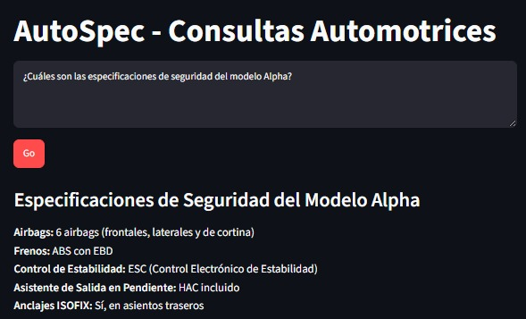
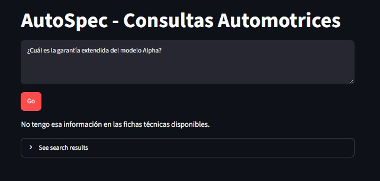

# Fase 3: RAG fuera de AWS (LangChain + ChromaDB + Gemini)

⬅️ [Volver al README principal](../README.md) · ⬅️ [Fase 2: RAG por componentes](../phase2-component-based-rag/README.md)

**Estado:** ✅ Implementación local ejecutada y pruebas funcionales realizadas · Portabilidad completa a AWS no probada (ver sección 7)

En esta fase implementé el patrón RAG fuera de AWS, con LangChain para la orquestación, ChromaDB como base vectorial y Google Gemini para generar embeddings y respuestas. La aplicación se ejecuta localmente con Streamlit.

En comparación con la Fase 2, cambiaron **dos elementos al mismo tiempo**: el proveedor de modelos y el framework de orquestación. Por eso los resultados permiten observar diferencias entre ambas implementaciones, pero no aislar el efecto de cambiar únicamente de proveedor.

## 1. Contexto y arquitectura

Al desarrollar esta fase no tenía acceso a AWS. Eso me permitió comprobar que el patrón RAG funciona fuera de ese ecosistema, con herramientas alternativas.

| Componente | Implementación |
|---|---|
| División de documentos | `RecursiveCharacterTextSplitter` de LangChain |
| Tamaño de fragmento / traslape | 500 caracteres / 100 caracteres |
| Embeddings | `gemini-embedding-001` |
| Base vectorial | ChromaDB local (`./chroma_langchain`) |
| Generación de respuestas | `gemini-3.6-flash` |
| Orquestación | Cadena de LangChain: `prompt \| llm \| parser` |
| Interfaz | Streamlit |

Los nombres y la disponibilidad de los modelos pueden cambiar: verifica que sigan disponibles antes de ejecutar.

### Flujo

1. Se leen las fichas técnicas desde `data/`.
2. LangChain divide los documentos en fragmentos y se antepone a cada uno el archivo de origen (igual que en la Fase 2).
3. Gemini genera los embeddings de los fragmentos.
4. ChromaDB guarda los vectores y el texto asociado.
5. Al consultar, se vectoriza la pregunta y se buscan los fragmentos más cercanos.
6. Los fragmentos recuperados se incorporan al prompt que recibe el modelo generativo.
7. Streamlit muestra la respuesta y los fragmentos recuperados.

## 2. Archivos

- `ingest.py`: ingesta (divide, genera embeddings con Gemini y guarda en ChromaDB).
- `rag_chain.py`: consulta (recupera fragmentos, construye el prompt y llama a Gemini). Devuelve la respuesta y los fragmentos con su distancia (en Chroma, **menor es más cercano**).
- `app.py`: interfaz con Streamlit.
- `data/`: las tres fichas técnicas (ficticias).
- `requirements.txt`: dependencias de Python.
- `.env.example`: plantilla de configuración para la clave de Gemini.

## 3. Configuración de la API de Gemini

La clave se crea en [Google AI Studio](https://aistudio.google.com/app/apikey). **Cada persona debe usar su propia clave.** Nunca se escribe en el código ni se sube al repositorio. El proyecto lee la variable `GEMINI_API_KEY` con `python-dotenv` desde un archivo `.env` local.

### Paso 1. Crear el archivo `.env`

Desde la carpeta `phase3-code-first-rag`:

- **Git Bash:** `cp .env.example .env`
- **PowerShell:** `Copy-Item .env.example .env`

Abre `.env` y reemplaza el texto de ejemplo por tu clave (una sola línea, sin espacios alrededor del `=`):

```dotenv
GEMINI_API_KEY=tu-clave
```

### Paso 2. Comprobar que Git ignora el archivo

```bash
git check-ignore -v .env
```

Debe mostrar la regla de `.gitignore` que lo excluye. Si no muestra nada, **no continúes**: revisa el `.gitignore` antes de hacer commit.

### Seguridad

- **No muestres tu clave en pantalla** (compartir pantalla, capturas, videos). En la charla en vivo mostré brevemente cómo queda el archivo `.env` para explicar cómo se carga, y **eliminé la clave en Google AI Studio en cuanto terminé**. Por eso el repositorio no incluye ninguna clave. Si la tuya se expone, revócala y crea otra.
- `load_dotenv()` **no sobrescribe** una variable que ya exista en el entorno: si `GEMINI_API_KEY` ya está definida en tu terminal, esa tiene prioridad sobre el `.env`.
- No imprimas la clave (`echo`, `print`) ni abras el `.env` frente a otras personas.
- Las cuotas dependen de tu cuenta y del modelo: revísalas en Google AI Studio.

## 4. Cómo ejecutar el proyecto

Requisitos: Python 3.10 o superior (probado con 3.13) y tu clave de Gemini. Todos los comandos se ejecutan desde `phase3-code-first-rag` y se probaron en Windows (Git Bash y PowerShell).

### Paso 1. Dependencias

Recomendado: un entorno virtual (no lo usé en mi ejecución).

- **Crear el entorno** (en ambas terminales): `python -m venv .venv`
- **Activarlo en Git Bash:** `source .venv/Scripts/activate`
- **Activarlo en PowerShell:** `.venv\Scripts\Activate.ps1`

Si PowerShell bloquea la activación por la política de ejecución de scripts, usa Git Bash. Con el entorno activo:

```bash
pip install -r requirements.txt
```

Dependencias: `langchain-chroma`, `langchain-core`, `langchain-google-genai`, `langchain-text-splitters`, `python-dotenv` y `streamlit`. Se identificaron a partir de los `import` del código; para reproducir exactamente un entorno, fija las versiones con `pip freeze`.

### Paso 2. Preparar la base vectorial

Si ya existe una base vectorial y quieres reconstruirla desde cero, primero **detén la app** y borra la carpeta de ChromaDB:

- **Git Bash:** `rm -rf chroma_langchain`
- **PowerShell:** `Remove-Item -Recurse -Force .\chroma_langchain`

> **Cuidado:** estos comandos borran la carpeta **para siempre**. Ejecútalos solo dentro de `phase3-code-first-rag` y solo si quieres reconstruirla. La primera vez la carpeta no existe: omite este paso o ignora el aviso.

Luego ejecuta la ingesta:

```bash
python ingest.py
```

En mi ejecución imprimió:

```text
Colección lista con 6 fragmentos
```

El número puede variar con el contenido de los documentos y la estrategia de división. **No ejecutes `ingest.py` dos veces sin borrar antes `chroma_langchain`:** podrían duplicarse los fragmentos.

### Paso 3. Iniciar la aplicación

```bash
streamlit run app.py
```

Streamlit muestra en la terminal la dirección local, normalmente `http://localhost:8501`.

## 5. Pruebas realizadas

Hice dos pruebas funcionales: una pregunta con respuesta en las fichas y otra sin respuesta.

### 5.1. Pregunta real: información disponible

**¿Cuáles son las especificaciones de seguridad del modelo Alpha?**

El sistema respondió con los cinco puntos de seguridad de Alpha.



### 5.2. Pregunta trampa: información no disponible

**¿Cuál es la garantía extendida del modelo Alpha?**

El sistema respondió con el mensaje fijo definido en el prompt, en lugar de inventar una garantía:

> No tengo esa información en las fichas técnicas disponibles.



### Alcance de las pruebas

Estas pruebas muestran el comportamiento ante dos consultas concretas. **No** son una evaluación sistemática de precisión, relevancia ni fiabilidad. Para evaluar formalmente haría falta un conjunto más amplio de preguntas con resultados esperados y medir de manera consistente la recuperación y la calidad de las respuestas.

## 6. Comparación de la división de documentos

Un hallazgo interesante fue cómo la estrategia de división afectó a la lista de seguridad de Alpha:

| Fase | Quién dividió | Resultado observado |
|---|---|---|
| 1 | Bedrock: 300 tokens y 20 % de traslape | La lista quedó dividida en dos fragmentos |
| 2 | Función propia: 500 caracteres y 100 de traslape | Se dividió, incluso a mitad de palabra |
| 3 | `RecursiveCharacterTextSplitter`: 500 y 100 | Quedó completa en un solo fragmento |

Con el mismo tamaño y traslape en las Fases 2 y 3, el resultado fue distinto: mi función corta por posiciones de caracteres, mientras que `RecursiveCharacterTextSplitter` intenta priorizar separadores naturales (saltos de línea, espacios) antes de partir el texto. En estas fichas eso conservó la lista completa en un solo fragmento. **No significa que LangChain siempre divida mejor:** depende de la estructura de los documentos. (300 tokens y 500 caracteres son unidades distintas: no los compares como si fueran lo mismo.)

## 7. Portabilidad a AWS: lo que probé y lo que no

### Lo que sí probé (prueba aparte)

En el entorno de laboratorio de AWS (Fase 2) instalé `langchain-aws` y comprobé que LangChain puede crear los modelos de Bedrock: `ChatBedrockConverse` con Nova Lite respondió, y `BedrockEmbeddings` con Titan V2 devolvió un vector de 1024 números. El script está en la Fase 2 (`probar_langchain_aws.py`).

```python
# Gemini: esta fase
GoogleGenerativeAIEmbeddings   ·   ChatGoogleGenerativeAI

# Bedrock: probado por separado
BedrockEmbeddings              ·   ChatBedrockConverse
```

### Lo que NO probé

**No probé la portabilidad completa con AWS**, es decir, correr esta Fase 3 entera con Bedrock. El motivo es práctico: mi cuenta tiene una **cuota diaria de tokens** limitada para los modelos de generación, que ya me bloqueó antes (`ThrottlingException`: *Too many tokens per day*), y lo más probable es que me hubiera vuelto a atascar. Es un límite de mi cuenta, no una limitación general de Bedrock. El entorno de laboratorio es temporal. No hay un fallo conocido en el código ni en LangChain: simplemente no se ejecutó.

### Lo que es probable (expectativa, no resultado)

Por el diseño de LangChain, que ofrece una interfaz común para modelos de distintos proveedores, lo más probable es que bastaría con cambiar **solo ciertas cosas**:

- **Las clases que crean los modelos:** en `ingest.py` (embeddings) y en `rag_chain.py` (embeddings de la pregunta y modelo de chat).
- **Credenciales y permisos de AWS:** para poder invocar los modelos.
- **Volver a ingestar:** los vectores de un modelo de embeddings no sirven para otro; la pregunta debe vectorizarse con el **mismo** modelo que los documentos.

Es una expectativa basada en cómo está pensado el framework. **Queda pendiente validarla** ejecutando el flujo completo con Bedrock y las mismas preguntas, cuando haya acceso y cuota para el modelo.

Un dato de la prueba aparte: Titan produjo vectores de 1024 números. No medí el tamaño de los de Gemini.

**Se mantiene en el diseño:**

- Las fichas técnicas.
- El tamaño del corte: 500 y 100.
- ChromaDB como base vectorial.
- El prompt y el flujo general.

**Puede cambiar:**

- El proveedor de embeddings.
- El modelo de generación.
- Las clases que crean los modelos.
- Los vectores guardados (hay que regenerarlos).

## 8. Comparación con la Fase 2

| Característica | Fase 2 | Fase 3 |
|---|---|---|
| Proveedor de modelos | Titan y Nova Lite (AWS) | Gemini |
| Acceso a los modelos | SDK de AWS (`boto3`) | Integraciones de LangChain |
| División de documentos | Función propia | `RecursiveCharacterTextSplitter` |
| Base vectorial | ChromaDB (`chromadb` directo) | ChromaDB (vía `langchain-chroma`) |
| Prompt | Mismo texto de instrucciones | Mismo texto de instrucciones |

Como cambiaron el proveedor **y** el framework, las diferencias no pueden atribuirse solo a Gemini ni solo a LangChain. Para una comparación más controlada, habría que usar el mismo framework, los mismos documentos y parámetros, y un protocolo de evaluación común.

## 9. Limitaciones y trabajo pendiente

- **Comparación no aislada:** cambian el proveedor y el framework a la vez.
- **Colección pequeña:** con pocos fragmentos y `k=8`, la búsqueda devuelve **toda** la colección; el filtro por modelo lo hace el prompt, no la búsqueda.
- **Sin evaluación sistemática:** no medí costo, latencia ni calidad de las respuestas.
- **Portabilidad a AWS sin validar** de extremo a extremo (sección 7).
- **Reproducibilidad:** las versiones de las dependencias y la disponibilidad de los modelos pueden cambiar.
- **Pendiente:** repetir el flujo con LangChain y Amazon Bedrock (Titan + Nova Lite) para aislar el efecto del proveedor.

## Conclusión

Esta fase muestra que el patrón RAG puede implementarse fuera de AWS con LangChain, ChromaDB y Gemini, que la estrategia de división influye en los fragmentos recuperados, y que la aplicación se comporta como se esperaba ante una pregunta con respuesta y otra sin respuesta en los documentos.

➡️ [Volver al README principal](../README.md)